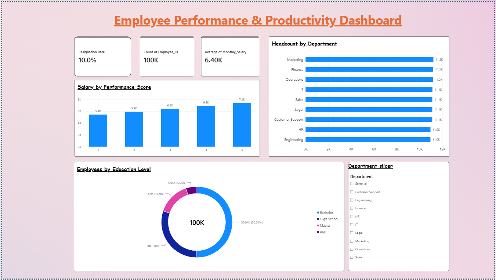
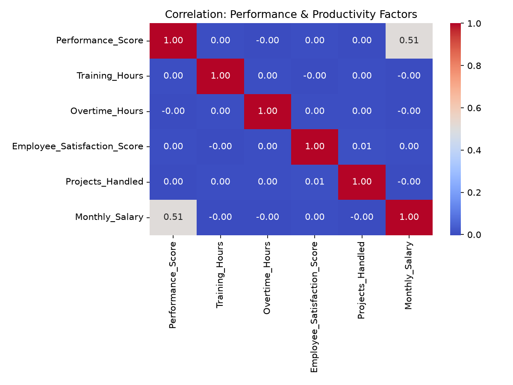
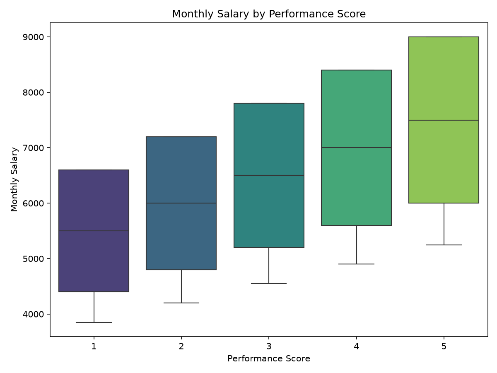

# HR Employee Performance Analysis: Python & Power BI

Python-based data cleaning and exploratory analysis of 100,000 employee records, visualized with an interactive Power BI dashboard.

## 📌 Overview
This project uses pandas to explore employee performance, salary, attrition, and productivity patterns, then presents the key findings in a Power BI dashboard. It demonstrates an end-to-end workflow: data validation and analysis in Python, followed by dashboarding in Power BI.

## 🗂️ Dataset
- **Source:** [Employee Performance and Productivity Data (Kaggle)](https://www.kaggle.com/datasets/mexwell/employee-performance-and-productivity-data)
- **Records:** 100,000 employees
- **Fields:** Department, Job Title, Hire Date, Years at Company, Education Level, Performance Score, Monthly Salary, Work Hours, Projects Handled, Overtime, Sick Days, Remote Work Frequency, Team Size, Training Hours, Promotions, Satisfaction Score, Resigned
- **Note:** The raw file is not included in this repo. Download it from the Kaggle link above.

## 🔧 Tools Used
- Python (pandas, NumPy, Matplotlib, Seaborn) in Jupyter Notebook
- Power BI (DAX measure for resignation rate, slicer-based interactive dashboard)

## 📁 Files
- `hr_data_analysis.ipynb`: full analysis notebook
- `cleaned_employee_data.csv`: dataset with added tenure-group column, used in Power BI
- `correlation_heatmap.png`, `salary_vs_performance.png`: analysis charts
- `python-dashboard.png`: Power BI dashboard screenshot

## 📈 Dashboard

## 🧹 Data Preparation
- Checked for missing values: none found across all columns
- Reviewed summary statistics for numeric fields
- Created a `Tenure_Group` column (0-1, 2-3, 4-5, 6-10 years) for tenure-based analysis
- Exported the enriched dataset for Power BI

## 📊 Key Findings

### 1. Salary rises consistently with performance
Performance Score and Monthly Salary show a **0.51 correlation**, the only strong relationship in the dataset. Average salary climbs steadily from about 5.4K at score 1 to about 7.4K at score 5.

### 2. Attrition is evenly spread
The overall resignation rate is **10.0%**. It stays between roughly 10% and 11% across every department, tenure group, and remote-work frequency (9.5% to 10.3%).

### 3. Operational factors show no meaningful link to performance or exits
Training hours, overtime, projects handled, and satisfaction score all show near-zero correlation with performance. Employees who resigned and those who stayed have almost identical average overtime (14.6 vs 14.5 hours), satisfaction (2.99 vs 3.00), and work hours (44.96 for both).

### 4. Education level barely changes pay
Average monthly salary is about 6.4K across PhD, Master, Bachelor, and High School groups.

## ⚠️ Note on the Data
The near-uniform distributions across departments, tenure, and education suggest this dataset is synthetically generated. The results above describe this dataset and should not be read as real-world benchmarks. The analysis approach, however, applies directly to real HR data.

## 💡 What This Suggests
- In this dataset, pay tracks performance, so compensation looks aligned with merit
- No single factor explains attrition, so with real data the next step would be adding exit-interview and engagement data
- Verifying data quality and distributions first prevents drawing false conclusions from noise

## 🔜 Next Steps
- Build a resignation prediction model to confirm that no factor is predictive
- Repeat the workflow on a real-world HR dataset

## 👤 About Me
HR professional with 2+ years in HR Shared Services and employee lifecycle operations, building applied analytics skills (Excel, SQL, Power BI, Python) to bridge HR operations with people analytics.

[LinkedIn](https://www.linkedin.com/in/hr-amit-sharma/)
